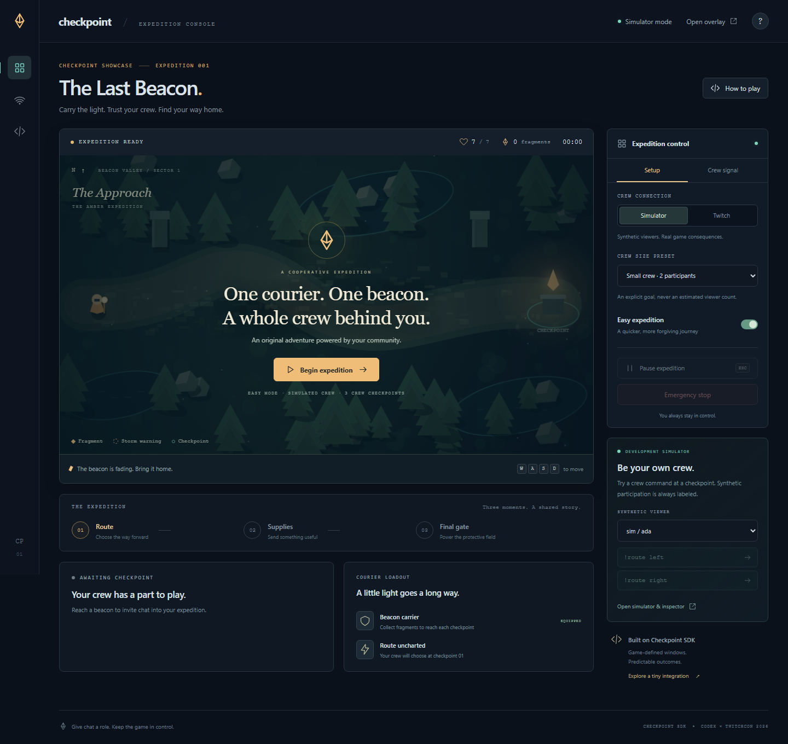

# Checkpoint

**Give chat a role. Keep the game in control.**

An open-source TypeScript SDK that turns Twitch chat into game decisions. Its playable showcase, **The Last Beacon**, lets viewers choose routes, send supplies, and power protection while the streamer pilots the courier.

**[Watch the 2:40 demo on YouTube](https://youtu.be/oaqdCqaklxE)** · [Connect your own game](docs/INTEGRATING_YOUR_GAME.md) · [Core API](packages/core/README.md) · [Contribute](CONTRIBUTING.md)



## Choose where to start

| I want to…                                | Start here                                                             |
| ----------------------------------------- | ---------------------------------------------------------------------- |
| Try the game without a Twitch account     | [Run the showcase](#run-the-showcase-no-twitch-required)               |
| Play with my own Twitch chat              | [Connect your Twitch channel](#connect-your-twitch-channel)            |
| Add interactions to my own game           | [Use the SDK](#use-the-sdk-in-your-own-project)                        |
| Understand the architecture or contribute | [Architecture](docs/ARCHITECTURE.md) · [Contributing](CONTRIBUTING.md) |

**Experimental API · 0.2.0 · MIT.** The core has zero runtime dependencies. Adapting another game requires developer access to its code or an integration provided by its developer; Checkpoint is not an automatic mod for arbitrary games.

## Run the showcase (no Twitch required)

Requires **Node.js 22.13+** (tested on 22.16), npm, and a modern browser. Initial dependency installation needs internet access or a populated npm cache. On Windows PowerShell, use `npm.cmd` instead of `npm` if script execution is blocked.

```sh
git clone https://github.com/Rohan-Saxena644/Checkpoint.git
cd Checkpoint
npm ci
npm run build
npm start
```

Already have the repository? Start at `npm ci`. Run commands from its root.

1. Open **http://localhost:4173/play** using `localhost` consistently.
2. Copy the private control code printed in the server terminal into **Unlock streamer controls**, then click **Unlock console**. Keep that code off stream.
3. Select **Simulator**, **Easy expedition**, and the one-person crew preset for a first run. Click **Begin expedition**.
4. Move with **WASD or arrow keys**. Collect **2 amber fragments** in each of the first three regions, then reach the beacon on the right. Leave yellow warning rings before they become red storm strikes. Cross the final region to win.
5. At a checkpoint, use the simulator command buttons to supply clearly labeled synthetic participation. You can also send nothing and observe the safe fallback. `/dev` provides the simulator inspector.

No `.env`, Twitch account, or paid API is needed for simulator mode. The simulator does not generate automatic fake viewers. Game and interaction timers pause together; use **Resume expedition** on the pause screen or in the streamer controls to continue. Screen-recording controls are separate from game controls.

### What chat can change

Each window normally lasts **18 seconds**. The streamer selects a crew preset of **1, 2, 5, or 10** before a run; the game does not guess viewer counts.

| Checkpoint | Chat commands                                       | Actual effect                                                                                                            | No-input fallback           |
| ---------- | --------------------------------------------------- | ------------------------------------------------------------------------------------------------------------------------ | --------------------------- |
| Route      | `!route left` / `!route right`                      | Shatterpath: 6 hazards and 4 salvage opportunities. Stillwater: 2 hazards and 2 opportunities. Both require 2 fragments. | Stillwater                  |
| Supplies   | `!supply shield` / `!supply heal` / `!supply boost` | Absorb one strike; restore up to 2 health; or move 50% faster for 15 seconds of active play.                             | Healing                     |
| Final gate | `!charge`                                           | Distinct participants meet the chosen target to grant 12 seconds of protection.                                          | 3 seconds of crossing grace |

## Connect your Twitch channel

You need your own Twitch developer app and explicit broadcaster authorization. Follow the complete [Twitch setup guide](docs/TWITCH_SETUP.md) for screenshots-independent setup details and official references.

1. Register a **Confidential** Twitch application with the exact redirect URL:
   `http://localhost:4173/auth/twitch/callback`.
2. Copy `.env.example` to **`.env`** in the repository root. Set `TWITCH_CLIENT_ID` and `TWITCH_CLIENT_SECRET` there. Keep the template unchanged; `.env` is Git-ignored. Never put the secret in browser code or a recording.
3. Restart the server with `npm start`, open `/play`, and unlock its streamer controls using the new terminal code.
4. Select **Twitch → Authorize broadcaster**. Sign in with the account whose channel will supply chat messages and accept the requested `user:read:chat` permission.
5. Wait for **Twitch connected**, then begin a Twitch expedition. Open your channel's chat in another tab. Send the displayed command **while its window is running**, not while paused or after expiry.

The adapter receives `channel.chat.message` v1 over EventSub WebSockets. It does not send chat messages. Live mode rejects simulator inputs. Tokens stay in server memory; restarting requires authorization again. Reconnection cannot replay missed chat.

**Already verified live:** OAuth/EventSub, route, shield supply, and a one-person cooperative goal through a winning run. Larger crews and transport-failure scenarios have separate automated/simulated coverage. See [verification details](docs/VERIFICATION.md).

### Broadcast and other pages

| Page       | Purpose                                                                                                                             |
| ---------- | ----------------------------------------------------------------------------------------------------------------------------------- |
| `/play`    | Game and authenticated streamer controls                                                                                            |
| `/overlay` | Read-only transparent OBS browser source; use `http://localhost:4173/overlay`, **640 × 1000**, 30 FPS. Capture the game separately. |
| `/dev`     | Labeled synthetic input and inspector for pause/recovery, invalid, duplicate and late inputs                                        |
| `/example` | Tiny local-button signal panel using the core, independent of the game and Twitch                                                   |

The overlay needs no control code. Keep privileged controls and secrets out of the broadcast. If transport recovery cannot complete, streamer controls offer an explicit **Cancel & use fair fallback** action; live data never silently becomes simulated input.

## Use the SDK in your own project

The SDK is not published to npm. Build a local package archive from this repository, then install it into your own ESM JavaScript/TypeScript project.

```sh
# From the Checkpoint repository root:
npm ci
npm run build:packages
npm run verify:package
```

The last command verifies the core archive and creates `.local/packages/checkpoint-core-0.2.0.tgz`. In **your own project's directory**, install it using its actual absolute path:

```sh
npm install /absolute/path/to/Checkpoint/.local/packages/checkpoint-core-0.2.0.tgz
```

Quote paths containing spaces. Import through **`@checkpoint/core`**, not internal source paths. The archive includes built ESM JavaScript, TypeScript declarations, README, changelog, and MIT license. Core code works in Node and browser projects without Twitch, React, the game, or the showcase server.

### A first choice, two participants, one effect

```ts
import { BoundedSet, Interaction, type Outcome } from "@checkpoint/core";

let now = 1000; // Injected clock makes this example reproducible.
const interaction = new Interaction(() => now);
const applied = new BoundedSet(128);
let signal = "amber";
let effects = 0;

const choice = interaction.open(
  "signal-001",
  {
    kind: "choice",
    options: ["amber", "cyan"],
    fallback: "amber",
  },
  10000,
);

for (const id of ["participant-a", "participant-b"]) {
  interaction.accept({
    windowId: choice.id,
    participantId: id,
    inputId: `input-${id}`,
    action: "cyan",
    sentAt: now,
  });
}

now += 10000;
interaction.tick(); // Your host normally calls tick() in its own loop.
const outcome = interaction.resolve()!;

function apply(result: Outcome) {
  if (result.windowId !== choice.id || applied.has(result.id)) return;
  applied.add(result.id);
  signal = result.value; // Replace this with your application's effect.
  effects++;
}
apply(outcome);
apply(outcome); // Repeated delivery does not apply another effect.
console.log(signal, outcome.participants, effects); // cyan 2 1
```

Run the existing console version with `npm run example`, or try the local-button panel at `/example`. Use fresh IDs for real windows and deliveries.

For Twitch in your own Node host, follow [Connect your own game](docs/INTEGRATING_YOUR_GAME.md): it covers installing both archives, TypeScript declarations, adapter wiring, OAuth callbacks, and applying effects. See the [Twitch package guide](packages/twitch/README.md) for its public API and the [core guide](packages/core/README.md) for choices, cooperative goals, lifecycle events, and the small `InputAdapter` contract.

**Checkpoint handles** validation, participation rules, timing, deterministic resolution, and bounded deduplication. **Your host handles** authenticated identities, eligibility, clock/transport health, game effects, and persistence. Twitch and the simulator both feed the same core; the game has no separate voting implementation.

Use a simple poll if you only need a displayed tally. Browser compatibility does not make client-side votes trustworthy: authoritative shared decisions belong in a trusted host.

## Development and checks

After the initial build, `npm run dev` starts the server with Vite browser hot updates. Restart it after server/SDK changes.

```sh
npm test                    # Core, synthetic Twitch, game and security tests
npm run typecheck
npm run lint
npm run test:core:offline    # Core with networking denied and secrets removed
npm run verify:package      # Built archive consumed outside the monorepo
npm run build
npx playwright install chromium
npm run test:e2e            # Browser suite owns port 4173; stop your server first
```

Current evidence: **47 tests**, strict type checking, lint, production build, and independent package consumption passed. The browser scenarios cover progression, failure/restart, no-viewer fallback, crew participation, recovery, overlay permissions, and mobile layout. Automated Twitch tests use mocked transport; they are distinct from the live verification above.

## Operational limits

- **Experimental 0.2.0:** long-term API stability is not promised. See the [changelog](CHANGELOG.md).
- **Memory-only state:** restart discards windows, participation, game progress, deduplication history, and OAuth tokens. Outcome guards are bounded in-process protection, not crash-safe exactly-once delivery. Persistent recovery belongs to the host.
- **One local authoritative process:** the showcase is not a hosted multi-tenant service. Static frontend hosting alone cannot run its Node/EventSub/WebSocket authority. Public deployment needs additional hosting, HTTPS, access-control and operational configuration.
- **Private controls, public spectators:** control mutations require an authenticated session and matching Origin. The overlay and public WebSockets are read-only. Tokens are never exposed through the browser, overlay or public state.

## Documentation and license

[Game integration](docs/INTEGRATING_YOUR_GAME.md) · [Twitch setup](docs/TWITCH_SETUP.md) · [Architecture](docs/ARCHITECTURE.md) · [Verification](docs/VERIFICATION.md) · [Contributing](CONTRIBUTING.md)

Checkpoint is **[MIT licensed](LICENSE)**. Game artwork is original procedural Canvas artwork; the game requires no runtime AI or paid service. Third-party dependency notices and asset provenance are documented in [Licensing](docs/LICENSING.md).

Built with OpenAI Codex for the Codex x TwitchCon hackathon. [Watch the demo](https://youtu.be/oaqdCqaklxE). Submission and recording materials are kept separately in [the handoff](docs/FINAL_VERIFICATION.md).
